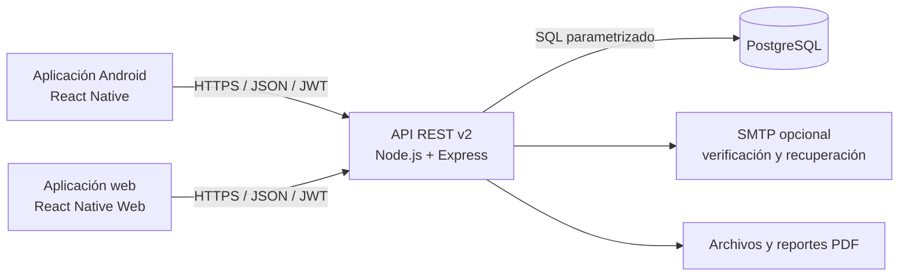
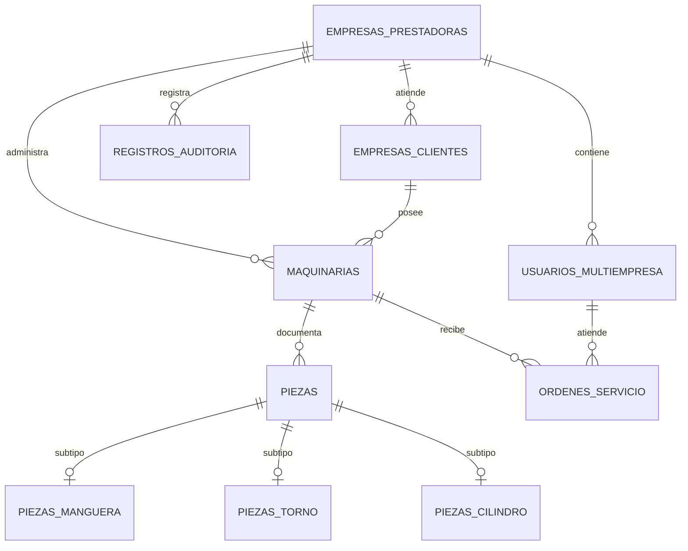

# Manual técnico de HydroTech


**Versión:** 1.0 · **Fecha:** 4 de noviembre de 2026
**Público:** desarrollo, QA, operaciones y mantenimiento

## 1. Alcance y arquitectura

HydroTech ofrece una aplicación móvil Android y una aplicación web construidas con las mismas pantallas React Native. Ambas consumen la API REST v2 en Node.js/Express y la misma base de datos PostgreSQL.



## 2. Tecnologías y requisitos

| Área | Tecnología configurada |
|---|---|
| Aplicaciones | React Native 0.86.2, React Native Web, React 19, JavaScript |
| API | Node.js, Express 4, `pg`, JWT |
| Base de datos | PostgreSQL |
| Pruebas | Jest, `node:test`, ESLint |
| Android | Gradle, JDK y Android SDK |
| Web / despliegue | Vite, Render y HTTPS |

El `package.json` raíz solicita Node.js `>=22.11.0`. Para compilar Android se necesita JDK y Android SDK compatibles con la configuración Gradle del proyecto.

Para compilar la web ejecuta `npm run build:web`; `npm run preview` compila y sirve el resultado en el puerto 4173. Durante la vista previa local, Vite reenvía `/api` y `/uploads` al backend en el puerto 3000. En producción, el backend sirve la compilación desde la raíz y comparte origen con la API.

## 3. Estructura del repositorio

```text
src/
  api/          cliente HTTP y módulos de API
  auth/         contexto, sesión y autenticación
  components/   componentes reutilizables
  navigation/   navegación de la aplicación
  screens/      pantallas por función
index.web.js    entrada web que registra las mismas pantallas de la app
vite.config.js  compilación web y proxy local para /api
backend/src/
  db/           conexión, esquemas, semillas y migraciones
  v2/           API REST actual, middlewares y rutas
  routes/       rutas de compatibilidad/legadas
docs/
  diagrams/     diagramas C4 en PlantUML
```

## 4. Modelo de datos

El esquema multiempresa se encuentra en [`schema.multiempresa.sql`](../backend/src/db/schema.multiempresa.sql). Las tablas y relaciones cambian por migración; antes de modificar la base, verificar el SQL vigente y respaldar los datos.



Los diagramas C4 en PlantUML están en [`docs/diagrams`](./diagrams/).

## 5. API REST

La aplicación web y la APK se conectan al prefijo `/api/v2`. Las rutas protegidas requieren autenticación JWT mediante la cabecera de autorización. La autorización de archivos depende de la ruta y sus middlewares; revisa su implementación antes de cambiar permisos.

| Prefijo | Funcionalidad |
|---|---|
| `/auth` | Registro, acceso, verificación, recuperación y perfil |
| `/client-companies` | Empresas clientes |
| `/users` | Personal y técnicos |
| `/machines` | Maquinaria |
| `/parts` | Piezas y revisión |
| `/orders` | Órdenes, asignación, estado y evidencias |
| `/notifications` | Notificaciones |
| `/reports` | Resúmenes y PDF |
| `/files` | Carga y descarga de archivos |
| `/audit` | Auditoría |

Ejemplos:

```text
POST  /api/v2/auth/login
GET   /api/v2/auth/me
GET   /api/v2/machines
POST  /api/v2/parts
PATCH /api/v2/orders/:id/assign
GET   /api/v2/reports/export.pdf
POST  /api/v2/files
```

Los cuerpos son JSON salvo cargas multipart. Los contratos completos se encuentran en `backend/src/v2/routes/`. Mantener validación de entradas, SQL parametrizado y filtro por `empresa_prestadora_id` en las consultas de datos empresariales.

## 6. Instalación y configuración local

```powershell
# En la raíz
npm ci

# Backend
Set-Location .\backend
npm ci
if (!(Test-Path .env)) { New-Item .env }
```

Configurar `backend/.env` con `DATABASE_URL` y `JWT_SECRET`; `PORT` es opcional. SMTP es necesario para enviar correos de verificación y recuperación. `OPENAI_API_KEY` es opcional para el asistente. Nunca copiar secretos en el repositorio ni en capturas.

Para aplicar esquemas e iniciar la API:

```powershell
cd backend
npm run migrate
npm run migrate:multitenant
npm start
```

Iniciar la aplicación web desde la raíz:

```powershell
npm run preview
```

Abrir `http://127.0.0.1:4173`. Los flujos conectados necesitan API y base de datos de desarrollo.

## 7. Autenticación, roles y seguridad

- Los roles principales son `admin`, `supervisor` y `tecnico`.
- La API valida JWT y permisos de rol; los middlewares de alcance aíslan datos por empresa.
- Las operaciones SQL deben usar parámetros y comprobar `empresa_prestadora_id`.
- La clave `JWT_SECRET` y credenciales SMTP se configuran como secretos del entorno.
- El límite de tamaño y tipos de archivos está definido en `backend/src/v2/routes/files.routes.js`.
- Los `.env`, claves de firma, datos de usuarios y respaldos no deben versionarse.

## 8. Pruebas, métricas y compilación

Comandos principales:

```powershell
# Raíz
npm run lint
npm test -- --runInBand

# Backend
cd backend
npm test
node --test __tests__/mailer.node.test.cjs __tests__/companyReportPdf.node.test.cjs

# APK de prueba (desde android/)
.\gradlew.bat assembleDebug
```

Los escenarios manuales están en [`PRUEBAS.md`](../PRUEBAS.md).

### Métricas de usabilidad

Registrar estas medidas al ejecutar sesiones con participantes representativos de cada rol. No hay que completar valores por anticipado: el repositorio documenta escenarios, no resultados de sesiones formales.

| Indicador | Cálculo o registro |
|---|---|
| Éxito de tarea | tareas completadas ÷ tareas intentadas × 100 |
| Tiempo por tarea | duración desde la consigna hasta completar la tarea |
| Errores | errores, pasos equivocados o correcciones requeridas |
| Ayuda | pistas o intervenciones necesarias |
| Dificultad percibida | valoración posterior de 1 (muy fácil) a 5 (muy difícil) |
| Comentarios | problemas de legibilidad, navegación, etiquetas y comprensión |

Por sesión, guardar fecha, rol, dispositivo, identificador anónimo del participante y medidas por tarea. No recopilar contraseñas ni datos personales. Comparar resultados antes y después de un cambio de interfaz para evaluar su efecto.

### Resultados de validación registrados

La última revisión local documentada (3 de noviembre de 2026) pasó lint, pruebas Jest, pruebas del backend, pruebas `node:test` de PDF/correo y compilación `assembleRelease`. Se detectaron avisos de auditoría en dependencias de desarrollo del árbol React Native/Metro/Jest/CLI; la corrección completa requería actualizar componentes fuera de los rangos actuales. Volver a ejecutar `npm audit` antes de publicar, porque el resultado depende del lockfile y del momento.

## 9. Despliegue y operación

La configuración de Render está en [`render.yaml`](../render.yaml): instala dependencias, aplica migraciones y arranca el backend. Configurar secretos en el panel del proveedor. Después de desplegar, revisar `/health`, logs y flujos de registro, acceso, archivos y reportes.

Definir y probar una política de backup y restauración en el proveedor de PostgreSQL. Antes de una migración importante, confirmar que existe un respaldo recuperable.

El APK release del proyecto usa firma de depuración: es adecuado para pruebas internas, no para Google Play. La publicación requiere una clave de release protegida, gestión de versiones y controles de distribución.

## 10. Problemas conocidos y mejoras

- Validar los flujos con dispositivos físicos y cuentas de prueba antes de capacitación o despliegue.
- Ejecutar pruebas de usabilidad y registrar métricas reales para priorizar mejoras.
- Actualizar React Native, Metro, CLI y Jest de manera coordinada; verificar compatibilidad y auditoría.
- Mantener documentación de contratos de API al introducir cambios.
- Establecer y probar procedimientos de respaldo y recuperación.

---

**Imágenes utilizadas:** logo del proyecto y captura existente del visor, enlazados dentro del documento. Los diagramas están escritos aquí mismo en Mermaid; no se generan archivos de imagen adicionales.
