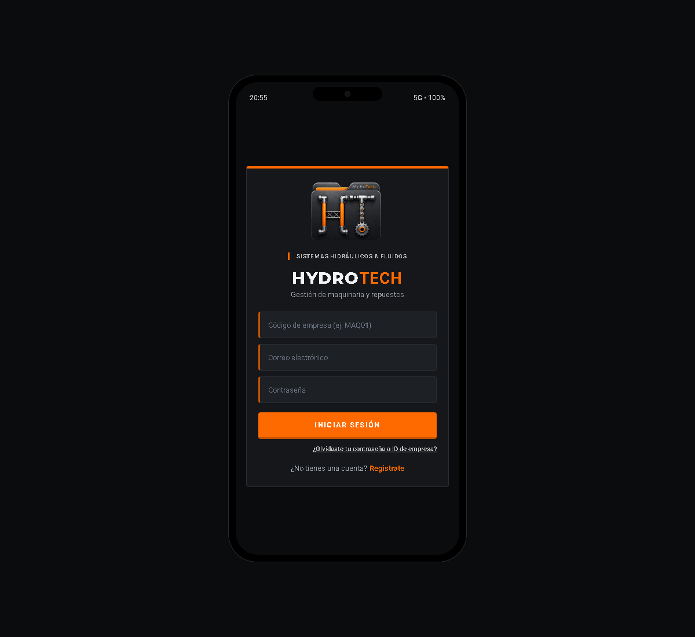

# Manual de usuario de HydroTech


**Versión:** 1.0 · **Fecha:** 4 de noviembre de 2026
**Público:** administradores, supervisores y técnicos

## 1. Presentación

HydroTech es una aplicación Android para consultar maquinaria, documentar piezas hidráulicas y coordinar órdenes de servicio. Las opciones que aparecen dependen del rol asignado a la cuenta y de la empresa asociada.

Esta guía describe los flujos previstos en la aplicación. Algunas acciones requieren que el backend y los servicios de correo estén disponibles.

## 2. Antes de empezar

- Ten a mano un dispositivo Android, conexión a internet y el APK proporcionado por la persona administradora.
- Necesitas el código de empresa, correo y contraseña de tu cuenta.
- Instala APK únicamente de una fuente de confianza.
- La primera conexión puede tardar si el servicio remoto está iniciando.

## 3. Iniciar sesión o crear una cuenta

1. Abre HydroTech.
2. Escribe el **código de empresa**, el **correo electrónico** y la **contraseña**.
3. Pulsa **Iniciar sesión**.
4. Si todavía no tienes cuenta, pulsa **Regístrate**, completa el formulario y sigue las instrucciones de verificación.
5. Si olvidaste la contraseña o el identificador de empresa, usa el enlace de recuperación en la pantalla de acceso.



*Figura 1. Pantalla del visor web de validación; es ilustrativa y puede variar ligeramente respecto al APK instalado.*

## 4. Roles

| Rol | Acciones principales |
|---|---|
| **Administrador** | Gestionar usuarios y empresas clientes, maquinaria, piezas, órdenes, reportes, foto de perfil y logo de empresa. |
| **Supervisor** | Consultar clientes y personal, administrar maquinaria, revisar piezas, crear y asignar órdenes y consultar reportes. |
| **Técnico** | Consultar maquinaria y piezas, registrar fichas para revisión, atender órdenes asignadas y adjuntar evidencias. |

El servidor también comprueba los permisos. Si no ves una opción o recibes un aviso de acceso denegado, consulta al administrador de tu empresa.

## 5. Tareas principales

### Consultar una máquina

1. En el panel principal, abre **Maquinaria y Equipos**.
2. Busca el equipo por su información visible.
3. Toca la máquina para consultar el detalle, la serie, la descripción y el manual disponible.
4. Las acciones para crear o modificar dependen de tu rol.

### Crear una ficha de pieza

1. Abre **Catálogo y Fichas de Piezas** y elige crear.
2. Selecciona la máquina y el tipo: **manguera**, **torno** o **cilindro**.
3. Completa los datos generales y las especificaciones que aparecen para ese tipo.
4. Adjunta fotos o documentos si son necesarios.
5. Guarda el borrador y, cuando esté listo, envíalo a revisión.
6. Revisa el estado. Si fue rechazada, abre el detalle, lee la observación, corrige la información y vuelve a enviarla cuando la opción esté disponible.

### Revisar y aprobar una pieza

1. Con una cuenta de administrador o supervisor, abre la bandeja de notificaciones o el catálogo.
2. Localiza la ficha pendiente y abre su detalle.
3. Comprueba máquina, especificaciones y evidencias.
4. Selecciona aprobar o rechazar según la revisión y confirma la acción.
5. Verifica que el estado actualizado aparezca en la ficha.

### Gestionar una orden de trabajo

1. Abre **Órdenes de Trabajo**.
2. El administrador o supervisor crea la orden, selecciona cliente y máquina, escribe el título y la descripción, define prioridad y asigna un técnico.
3. El técnico abre la orden asignada y registra el avance.
4. Adjunta evidencia con descripción y etapa: **antes**, **durante** o **después**.
5. Actualiza el estado de acuerdo con el trabajo realizado y confirma que el detalle refleje los cambios.

### Consultar notificaciones

1. Abre **Bandeja de Notificaciones**.
2. Lee el título y el detalle.
3. Abre la pieza u orden relacionada para completar la tarea pendiente.

### Generar un reporte

1. Abre **Reportes y Métricas** si tu rol tiene permiso.
2. Consulta el resumen o elige exportar el informe PDF.
3. Guarda el documento en una ubicación conocida del dispositivo.

### Cambiar foto o logo

1. Abre **Mi Perfil y Configuración**.
2. Toca la foto de perfil y selecciona cámara o galería.
3. El administrador puede cambiar también el logo de la empresa.
4. Espera el mensaje de confirmación antes de salir.

## 6. Solución de problemas

| Problema | Qué puedes hacer |
|---|---|
| El acceso tarda o falla | Comprueba la conexión e inténtalo de nuevo. El primer acceso puede tardar mientras inicia el servicio. |
| No aparece un módulo | Confirma empresa y cuenta. Solicita al administrador revisar tu rol. |
| No llega un correo de verificación | Revisa que el correo esté escrito correctamente y la carpeta de spam. Si no llega, avisa al administrador; el servidor debe tener correo configurado. |
| No carga una foto o archivo | Comprueba conexión, permisos de cámara/galería, formato y tamaño; vuelve a intentarlo. |
| No se guarda una acción | Espera el mensaje de resultado y revisa la conexión. Si el problema continúa, guarda el texto del error y contacta al administrador. |
| Una pieza está rechazada | Lee la observación en el detalle, corrige los datos y vuelve a enviarla si está habilitado. |

Al pedir soporte, indica tu rol, la empresa, la pantalla, los pasos realizados y el mensaje de error. **Nunca envíes contraseñas ni códigos de verificación.**

## 7. Evaluación de usabilidad

Esta sección sirve para registrar pruebas con usuarios. El repositorio documenta recorridos manuales, pero no contiene resultados de sesiones formales; por eso no se atribuyen aquí resultados no medidos.

### Métricas que se deben registrar

| Métrica | Cómo medirla | Registro |
|---|---|---|
| **Éxito de tarea** | Tareas completadas correctamente ÷ tareas intentadas × 100 | ____ % |
| **Tiempo por tarea** | Tiempo desde que se presenta la tarea hasta que se completa | ____ min/seg |
| **Errores** | Número de errores, selecciones incorrectas o datos que hubo que corregir | ____ |
| **Ayuda necesaria** | Veces que la persona pidió ayuda o recibió una pista | ____ |
| **Dificultad percibida** | Valoración del participante después de la tarea, por ejemplo de 1 (muy fácil) a 5 (muy difícil) | ____ / 5 |
| **Comentarios** | Dudas, mensajes confusos, controles difíciles de encontrar o sugerencias | __________ |

### Hoja de sesión

```text
Fecha: ____________________     Dispositivo: ____________________
Rol probado: ______________     Facilitador: ____________________
Participante (código anónimo): _________________________________

Tarea                         Éxito (S/N)   Tiempo   Errores   Ayudas   Comentario
Iniciar sesión                ___________   ______   _______   ______   __________
Consultar una máquina         ___________   ______   _______   ______   __________
Crear una ficha de pieza      ___________   ______   _______   ______   __________
Revisar una orden             ___________   ______   _______   ______   __________
Adjuntar una evidencia        ___________   ______   _______   ______   __________
Encontrar un reporte          ___________   ______   _______   ______   __________
```

Prueba la app con datos ficticios y participantes que representen los tres roles. Pide que piensen en voz alta, pero evita indicarles dónde tocar. No registres contraseñas, correos reales ni datos personales. Resume hallazgos sin identificar a los participantes.

## 8. Glosario y contacto

- **Empresa prestadora:** empresa de servicio que administra su operación en HydroTech.
- **Empresa cliente:** empresa propietaria o usuaria de la maquinaria atendida.
- **Ficha de pieza:** registro técnico de un componente.
- **Evidencia:** foto o nota que documenta el trabajo.
- **APK:** archivo instalable para Android.
- **Rol:** permisos que determinan las acciones de una cuenta.

Para soporte, contacta al administrador de HydroTech de tu empresa.
